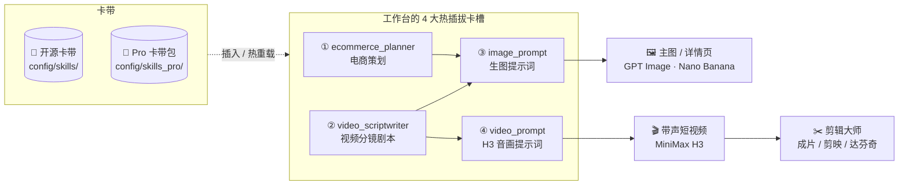
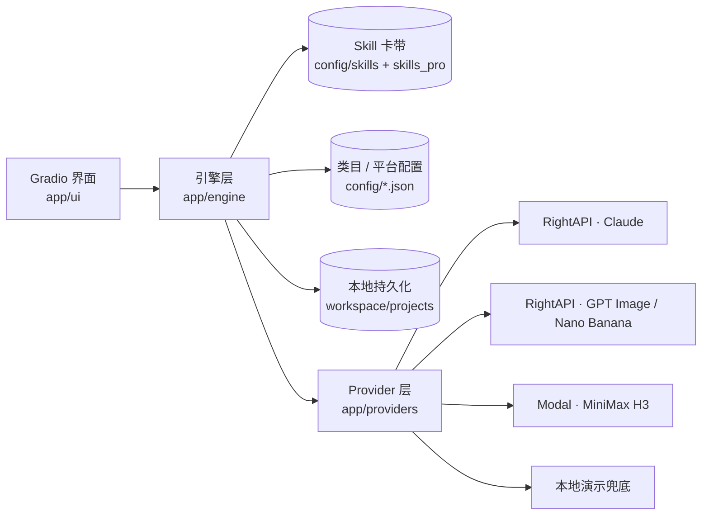

<div align="center">

# 🏭 老庹 AI 电商内容工厂

**Laotuo AI E-Commerce Studio**

「插卡式 Skill 驱动」的全链路电商视觉工作台 —— 一键生成高转化主图、深度详情页、MiniMax H3 原生音画带货视频与剪映 / 达芬奇后期工程


[快速启动](#-3-分钟快速启动) · [插卡式架构](#-任天堂插卡式-skill-架构) · [商业版与定制](#-商业版本与定制服务) · [商务合作](#-商务合作)

</div>

选好类目和平台、填好商品信息，在一个本地 Web 界面里产出五类素材：

- 主图：按平台建议张数策划，逐槽位并发出图、勾选定稿、打包导出。
- 详情页：按屏规划，生成长图序列预览。
- 带货短视频：MiniMax H3 原生音画一体，画面和声音一次产出；先锁定首帧再生成，商品不变形。成片可一键合成 mp4，或导出剪映草稿、达芬奇工程继续精剪。
- 配音：VoxCPM2 口播配音，逐段生成后拼接，导出 wav / mp3 / srt。
- 动效广告：用项目里已有的主图、详情页、首帧和分镜视频，按节拍编排一条动效广告。画面、配乐、音效全部由本机代码渲染，**不调用任何生图 / 生视频接口，不消耗画图额度**。

全部 AI 能力由 Markdown「卡带」驱动，代码里不写死提示词。**没有 API Key 也能完整体验全流程**（零 Key 演示模式）。

## 目录

- [🔥 为什么通用 AI 做不出能卖货的电商图？](#-为什么通用-ai-做不出能卖货的电商图)
- [功能一览](#功能一览)
- [🎮 任天堂插卡式 Skill 架构](#-任天堂插卡式-skill-架构)
- [🚀 3 分钟快速启动](#-3-分钟快速启动)
- [💼 商业版本与定制服务](#-商业版本与定制服务)
- [配置说明](#配置说明)
- [使用教程](#使用教程)
- [系统架构](#系统架构)
- [扩展开发](#扩展开发)
- [开发与测试](#开发与测试)
- [安全须知](#安全须知)
- [贡献指南](#贡献指南)
- [许可证](#许可证)
- [致谢](#致谢)

## 🔥 为什么通用 AI 做不出能卖货的电商图？

通用 AI 工具能画出好看的图，但电商图要同时做到四件事：商品是真的、细节是对的、文案合规、能让人下单。

| 电商图的硬要求 | 普通 AI 工具 | 老庹 AI 内容工厂 |
|---|---|---|
| ① 商品不走样 | 凭空画包装，包装字乱码、logo 变形 | **0 / 1 / 多图路由**：按实际上传的商品参考图数量，自动选文生图、单图保真编辑或 2~3 图融合；视频**先锁定首帧再生成**，并把商品参考图一起交给 H3（Ref2VA）。中文排版有 8 条防变形底线（逐字锁死、平面正视、高反差等） |
| ② 品类细节画对 | 不认识品类，莓茶白霜画成发霉、草本切片画成一堆木屑 | 类目配置写清品类特征（如莓茶白霜是黄酮自然析出、不是霉变），配合**光学微距构图**；草本原料按《中国药典》性状图谱逐味入画，同框易混的原料单独提醒 |
| ③ 懂广告法 | 文案里常出现「最」「第一」、功效承诺 | 广告法与类目违禁词**实时检查**；卡带内置合规红线，所有示范句由自动化测试逐条校验 |
| ④ 文案和视频会卖货 | 文案像说明书，视频开头留不住人，后期还要从头剪 | **三维视觉美学**（5 大美学流派 × 6 大构图 + 8 种中文排版方案）+《电商高转化文案写作指南》（FAB、五感具象、场景点名、诚实交底）；视频黄金 3 秒钩子模板、**Hypit 爆款视频结构克隆**；剪辑大师一键成片，**剪映 / 达芬奇工程一键导出** |

## 功能一览

- 三步式策划工作流：填写想法（选填）→ AI 生成草稿 → 人工编辑并确认。确认后才能传图和渲染。
- 生图模式自动判定：按参考图数量在文生图（0 张）、单图保真编辑（1 张）、多图融合（2~3 张）之间路由。
- 参考图按角色登记：同一角色（如 `product_package`）上传一次，自动绑定到所有需要它的槽位。
- 视觉设计体系：5 大美学流派 × 6 大构图模式，可整套统一，也可逐槽位指定。
- 视频双路策划：原创剧本，或克隆参考爆款视频的结构（本地抽帧 → 拆解 → 替换为本品）。
- MiniMax H3 提示词自动编写：内置官方 `h3-prompt-writing` 技能。分镜绑定了商品参考图时用 Ref2VA，否则用 I2VA，无需手动选择。
- 视频版本管理：每个分镜单独显示最新视频，重新生成会保存为新版本，不覆盖旧视频。
- 剪辑大师一键成片：自动定位台词、排顺序、加转场和字幕花字，导出 mp4、剪映草稿或达芬奇工程。
- 零成本代码动效广告：分镜按整数拍排期，每一刀都落在节拍上；逐字遮罩上升、动势衔接转场、本机合成配乐与音效；每次渲染自动出联系表和 11 项自检报告（节拍、阅读时间、安全区、响度等）。
- 三路并发：主图、详情页、视频三个选项卡各自排队，互不阻塞；切换选项卡不会中断任务。
- 实时回显：运行日志实时滚动，图片生成一张显示一张。
- 本地持久化：所有状态写入 `workspace/projects/`，重启后可恢复历史项目。
- 合规检查：按广告法与类目违禁词实时提示。

## 🎮 任天堂插卡式 Skill 架构

工作台是「游戏机」，每项 AI 能力是一个「卡槽」，Markdown 卡带是「游戏卡」。换一张卡带就换一套策划、编剧或提示词写法，不用改一行代码。



除 4 大主卡槽外，还有视频进阶编剧（`concept_writer`、`story_scriptwriter`）和剪辑大师（`video_editor`）。卡槽由文件夹名决定：

| 卡槽 | 用途 |
|---|---|
| `ecommerce_planner` | 主图 / 详情页策划 |
| `concept_writer` | 视频创意大纲 |
| `story_scriptwriter` | 视频完整剧本（按视频类型分卡带） |
| `video_scriptwriter` | 视频分镜剧本（原创 / 爆款克隆） |
| `image_prompt` | 生图提示词（GPT Image / Nano Banana） |
| `video_prompt` | MiniMax H3 音画提示词 |
| `video_editor` | 剪辑大师：分镜视频 → 剪辑方案（顺序、出入点、转场、卖点花字） |
| `voice_writer` | 配音文案（VoxCPM2 口播） |
| `motion_director` | 动效导演：项目素材 → 动效方案（结构、文案、素材、拍数、镜头、转场） |

卡带格式为 YAML front matter + Markdown 正文：

```markdown
---
skill_id: my_planner_v2          # 必填，全局唯一，小写字母 / 数字 / 下划线
name: 我的策划 Skill              # 必填，界面显示名
description: 一句话说明            # 选填
version: "1.0"                   # 选填
variables: [product_name]        # 选填，声明正文使用的变量
default: false                   # 选填，true 表示该卡槽默认选中
categories: [zhangjiajie_berry_tea]  # 选填，类目专属卡带；不写则所有类目可用
references: [references/guide.md]    # 选填，附属指南，加载时自动读入
---
正文……可以使用 {{ product_name }} 这样的变量占位。
```

- 新卡带放进对应文件夹即可被识别，按文件修改时间热重载，无需重启。
- 渲染时缺少变量会报错，不会把未填充的占位符发给模型。
- 单张卡带解析失败不影响其他卡带，错误显示在界面上。
- 界面「🔌 插卡式 Skill 管理与在线微调」可预览正文，并临时覆盖当前会话的指令，覆盖内容不写回文件。
- 附属指南只允许放在卡带同目录的 `references/` 下，单文件不超过 200KB。

### 🧬 卡带继承

行业卡带不必把通用规则整份复制一遍，可以继承同卡槽的另一张卡带，只写不一样的部分：

```markdown
---
skill_id: my_tea_planner
name: 我的茶叶策划
extends: default_planner         # 继承默认策划卡带的全部区块
categories: [zhangjiajie_berry_tea]
---
# 角色 {#role}
……整块替换父卡带的「角色」……

# 合规红线 {#compliance after=task}
……新增区块，插在「本次任务」之后……

# {#copywriting append}
……追加到父卡带「文案规则」末尾……

# {#anti_duplicate remove}
```

- 区块用一级标题尾标 `{#区块id}` 标出，发给模型前会去掉标记。`default_planner` 的区块：`role`、`task`、`planning_rhythm`、`generation_mode`、`anti_duplicate`、`visual_system`、`copywriting`、`output_format`、`self_check`。
- 标为 `final` 的区块（`task`、`output_format`）只能追加不能替换，保证所有策划卡带输出同一种 JSON。
- `variables`、`references` 自动合并；`categories`、`default` 不继承。
- 只能继承同一卡槽的卡带，最多 3 层；开源卡带不能继承 Pro 卡带。
- 查看展开后的完整提示词和每个区块的来源：`python -m app.engine.skill_loader --resolve my_tea_planner`。

### 👑 Pro 卡带包

`config/skills_pro/` 是商业 Pro 卡带包的安装位置，目录结构与 `config/skills/` 相同（`{卡槽}/*.md`，可带 `references/`）。

- 拿到 Pro 卡带包 zip 后，解压到 `config/skills_pro/`，点「🔌 插卡式 Skill 管理」里的「🔄 重新扫描本地 .md 卡带」即可使用，不用重启。
- Pro 卡带在下拉框中显示为「[👑 Pro] 卡带名」；类目专属的 Pro 卡带在切换到该类目时自动选中。
- Pro 卡带可以直接引用开源卡槽 `references/` 下的同名指南，卡带包里不用重复携带。
- `skill_id` 与开源卡带重复的 Pro 卡带不会覆盖开源卡带，会作为错误显示出来。
- 界面顶部「👑 老庹 AI 工坊」入口可以查看当前加载了哪些开源 / Pro 卡带。
- `config/skills_pro/` 已被 `.gitignore` 忽略，不会被提交到仓库。

## 🚀 3 分钟快速启动

### 环境要求

- Python 3.11 或更高版本（开发环境为 3.14）
- 无需 Node.js、Redis 或 Docker。视频抽帧所需的 ffmpeg 由 `imageio-ffmpeg` 自带
- 演示图会用到中文字体：Windows / macOS 自带；Linux 请安装 Noto CJK 或文泉驿字体

### 安装与启动

```bash
git clone https://github.com/tuolin2013/laotuo-ai-studio.git
cd laotuo-ai-studio

python -m venv .venv
# Windows（Git Bash）
.venv/Scripts/python -m pip install -e ".[dev]"
# macOS / Linux
# .venv/bin/python -m pip install -e ".[dev]"

cp .env.example .env          # 不填任何 Key 也能启动（演示模式）
.venv/Scripts/python -m app.main
```

浏览器打开 http://127.0.0.1:7860 。

### 还没有 API Key？直接用演示模式

**不填任何 Key 也能立即体验完整全链路**：策划 → 编辑确认 → 传图 → 出图 → 视频剧本 → 首帧锁定 → 生成视频 → 剪辑成片 → 导出剪映 / 达芬奇。

- 没填 Key 的通道会自动走本地演示：策划和剧本使用与真实输出结构一致的演示数据，图片由本机绘制真实中文排版的预览图（右上角带「DEMO」角标），视频由本机 ffmpeg 合成。
- 已经填了 Key，也可以在「⚙️ API 密钥与接口配置」里勾选「🧪 本地演示测试模式」，强制全部走演示。
- 演示模式不联网调用任何付费接口，不消耗额度。

体验满意后，再按[配置说明](#配置说明)填入 Key，切换到真实生成。

## 💼 商业版本与定制服务

本项目采用 Open-Core 模式：工作台底座开源免费，深度行业卡带与交付服务收费。

| | 🌱 开源社区版 | 👑 商业专业版 | 🏢 企业尊享定制版 |
|---|---|---|---|
| 英文名 | Community Free | Pro Skill Packs | Enterprise Turnkey |
| 工作台底座 | ✅ 完整功能（主图 / 详情页 / 视频 / 剪辑导出） | ✅ | ✅ |
| 卡带 | 通用策划、编剧、提示词卡带 | 深度行业高转化卡带包，如《张家界莓茶 / 传统茗茶专享包》《宠物营养补充剂 · 情感共鸣包》；实拍微距增强配置；持续更新的爆款脚本库 | 品牌专属 SKU 卡带一对一深度定制 |
| 部署 | 本地自部署 | 本地自部署，解压卡带包即用 | 免配置云端独享工作台（含 Modal H3 高速视频后端） |
| 服务 | GitHub Issue 交流 | 卡带更新 | 成品视觉包代制作、团队培训 |
| 适合 | 开发者、愿意自己动手的店主 | 想直接用上行业打磨过的卡带的卖家 | 品牌方、代运营公司 |

### 📬 商务合作

> **定制专属行业 Skill 卡带 / 获取云端独享版 / 视觉包代制作**
>
> - 微信：`（待填写）`
> - 邮箱：`（待填写）`
> - 公众号：`（待填写）`

<!-- 填写真实联系方式时，同步修改 app/ui/pro_panel.py 中的 CONTACTS（界面顶部「👑 老庹 AI 工坊」入口） -->

## 配置说明

所有配置在 `.env` 中（模板见 [.env.example](.env.example)），也可以在界面「⚙️ API 密钥与接口配置」中修改并写回 `.env`。

### 三个通道，独立判定真实 / 演示

| 通道 | 需要的配置 | 用途 | 未配置时 |
|---|---|---|---|
| LLM | `RIGHTAPI_LLM_KEY` | 执行全部 Skill（策划、编剧、提示词） | 演示数据，JSON 结构与真实输出一致 |
| 画图 · image 高质量 | `RIGHTAPI_IMAGE_KEY` | GPT Image / Nano Banana 生图（生产默认） | PIL 绘制中文排版的预览图，带「DEMO」角标 |
| 画图 · image 普通 | `RIGHTAPI_IMAGE_STD_KEY` | 普通渠道的 GPT Image / Nano Banana 模型 | 同上 |
| 视频 | 本机已登录 Modal | 调用自行部署的 MiniMax H3 服务 | ffmpeg 合成演示视频 |

`DEMO_MODE=true` 会强制所有通道走演示模式，即使已填写 Key。

### 常用配置项

| 变量 | 默认值 | 说明 |
|---|---|---|
| `RIGHTAPI_BASE_URL` | `https://www.rightapi.ai` | RightAPI 网关地址，会自动补全协议、去掉结尾的 `/v1` |
| `RIGHTAPI_LLM_MODEL` | `claude-opus-5-5` | LLM 模型 |
| `RIGHTAPI_LLM_API_FORMAT` | `auto` | `anthropic`（`/v1/messages`）/ `openai`（`/v1/chat/completions`）/ `auto` 自动探测 |
| `RIGHTAPI_IMAGE_STD_BASE_URL` | 空（同 `RIGHTAPI_BASE_URL`） | 普通渠道的 Base URL |
| `RIGHTAPI_IMAGE_MODELS` | 两个渠道全部 11 个模型 | 界面可选的画图模型，必须是已登记的模型 |
| `RIGHTAPI_IMAGE_BUSY_RETRIES` | `3` | 上游繁忙时自动重新提交的次数，`0` 关闭 |
| `RIGHTAPI_IMAGE_RESOLUTION` | `2K` | `1K` / `2K` / `4K` |
| `RIGHTAPI_IMAGE_QUALITY` | `high` | GPT Image 质量档，`xhigh` / `max` 仅 2.5 模型可用 |
| `RIGHTAPI_IMAGE_CONCURRENCY` | `8` | 本机同时进行的画图任务数 |
| `MODAL_H3_APP` / `MODAL_H3_CLASS` | `minimax-h3-diffusers-service` / `H3BatchRunner` | Modal 上 H3 服务的应用名与类名 |
| `GRADIO_SERVER_NAME` | `127.0.0.1` | 监听地址，见[安全须知](#安全须知) |
| `GRADIO_SERVER_PORT` | `7860` | 监听端口 |

### 画图模型

协议由模型决定，不按名字猜测。所有模型在 [app/providers/image_models.py](app/providers/image_models.py) 中显式登记，未登记的模型会被拒绝调用。

| 渠道 | 模型 | 协议 |
|---|---|---|
| image 高质量（推荐） | `gpt-image-2.5-flare`、`gpt-image-2.5-sunburst`、`gpt-image-2` | OpenAI 生成 / 编辑接口 |
| image 高质量（推荐） | `gemini-3-pro-image-preview`、`gemini-nano-banana-2.1` | Gemini `generateContent` |
| image 普通 | `gpt-image-2`（目录 ID `gpt-image-2@image`）、`gpt-image-2-vip`、`gpt-image-2.5` | OpenAI 生成 / 编辑接口 |
| image 普通 | `nano-banana-pro`、`nano-banana-2`、`nano-banana-2-lite` | Gemini `generateContent` |

全部请求以异步任务提交并轮询结果，接口细节以 [RightAPI 官方文档](https://docs.rightapi.ai/docs/rc_draw/) 为准。

### MiniMax H3 视频服务（可选）

本仓库只包含调用端，不包含 H3 服务端部署脚本。如需真实生成视频：

1. 在 Modal 上自行部署 MiniMax H3 服务，提供 `H3BatchRunner` 类（可通过 `MODAL_H3_CLASS` 修改）：
   - 构造参数 `workflow="ref2va"`
   - 方法 `render_single_shot(prompt, images, frames, seed, steps, aspect_ratio)`，`images` 为图片字节列表，返回 mp4 字节
2. 在本机登录 Modal：`modal token new`
3. 在界面点击「🔎 检查 Modal H3 服务（不启动 GPU、不扣费）」确认可用

冒烟测试脚本 [scripts/h3_smoke_test.py](scripts/h3_smoke_test.py) 会真实占用 GPU 并产生费用。

未登录 Modal 或开启演示模式时，视频由本地演示后端（ffmpeg 合成）生成，可以先走通完整流程。

## 使用教程

### 1. 准备项目（顶部控制栏）

1. 点击「➕ 新建项目」，或在下拉框中选择历史项目后点「📂 加载」。
2. 选择类目和平台。内置类目：张家界莓茶、宠物营养补充剂；内置平台：淘宝 / 天猫、拼多多、微信小店 / 视频号小店。开源版两个类目都使用通用策划卡带；安装了对应的 Pro 卡带包后，切换类目会自动选中该类目的专属卡带。
3. 展开「📝 商品信息」填写表单。表单字段随类目变化，下方实时显示合规检查结果。
4. 配好 Key 后，点「🩺 连通性诊断」验证。诊断不提交画图任务，不消耗额度。

### 2. 主图 / 详情页

两个选项卡流程相同，以主图为例。

Step 1　生成与编辑策划案

1. 在「💡 我的策划想法（选填）」写下创意方向。填写后作为最高优先级约束；留空则由 AI 根据类目和平台自主策划。
2. 选择「🎨 全局视觉设计美学流派」、张数与比例，点击「✨ 生成主图策划案」。
3. 在表格中修改标题、文案、画面描述、构图、参考图需求，点「💾 保存表格修改」。也可以单独重新生成某个槽位，或增删、调整槽位顺序。
4. 满意后点「✅ 确认主图策划案，生成传图清单」。系统会汇总出去重后的《所需参考图清单》。如需再改，点「🔓 解锁返回修改策划」。

Step 2　按清单传图与并发渲染

1. 按清单上传参考图。每个角色只需上传一次，会自动绑定到所有相关槽位。「♻️ 一键复用」可直接使用项目内其他模块已上传的图。
2. 个别槽位需要不同的参考图时，在「🎯 为特定槽位单独上传 / 替换参考图」中绑定。
3. 选择生图模型、分辨率、质量档和每槽位候选数量（1~4），点击「🚀 开始并发生成主图」。
4. 在「⭐ 勾选定稿图」中选出每个槽位的定稿，点「⭐ 保存定稿勾选」，再点「📦 打包导出定稿」下载 zip。

详情页选项卡额外提供「📜 详情页长图序列预览」，按屏顺序拼出每屏定稿图。

### 3. 带货短视频

视频的防变形链路：

```
剧本 → 确认剧本 → 生成首帧（比例与视频一致）→ 锁定首帧 → 自动编写 H3 提示词 → Modal H3 生成带声视频
```

前一步未确认时，后一步不可执行。

Step 1　分镜剧本（二选一）

- 📝 自己策划原创剧本：选择视频类型（场景种草 / 产品展示 / 信任背书 / 对比测评 / 情感故事）、分镜数量和比例，点「✨ 生成带货视频剧本」。也可以在「🧭 进阶（原创）」中按「① 创意大纲 → ② 完整剧本 → ③ 编译为分镜」三步走。
- 📹 克隆参考爆款视频：上传一段参考视频（.mp4 / .mov / .webm），系统在本地抽取 4~8 张关键帧，拆解原片的钩子与节奏，再按原片结构替换为当前商品。

两种方式都会填入同一张可编辑的分镜表。每个分镜包含声音设计：人物同期声对白、环境音与动作音效，或静音。H3 原生生成声音，所以没有单独的画外音轨。编辑完成后点「✅ 确认分镜剧本」。

Step 2　首帧锁定

1. 在「2.1」中按汇总清单上传首帧所需的参考图。
2. 在「2.2」中点「🖼️ 开始批量生成各分镜首帧候选图」。
3. 在「2.3」中为每个分镜勾选一张商品没有变形的首帧，点「🔒 保存首帧锁定勾选」；或用「🔒 全部分镜自动锁定最新首帧」快速锁定。

Step 3　MiniMax H3 生成带声视频

1. 选择生成方式：
   - ① 逐个分镜依次生成（默认）：生成全部已锁定首帧的分镜。勾选「跳过已有视频的分镜」时，只补齐还没生成的。
   - ② 选分镜生成：只生成勾选的分镜。
2. 点「🎬 开始生成视频」。分镜排队逐个生成，每个约 5~8 分钟；某个分镜失败不影响其余分镜。
3. 在「🎞️ 各分镜视频」中查看结果，每个分镜一个播放器，显示最新版本。重新生成会保存为第 N 版，旧版本在「🗂️ 全部视频版本」中。

H3 提示词由系统在生成前自动编写，写法按分镜自动选择：

- 绑定了商品参考图：Ref2VA，`<Picture 1>` 为锁定首帧，`<Picture 2>` 起为商品参考图，包装更稳定。
- 没有参考图：I2VA，只使用锁定首帧。

如需查看或微调，展开「📝 H3 音画提示词（系统自动编写，可选查看 / 微调）」，可重新编写单个分镜或全部分镜，改完点「💾 保存微调」。

H3 帧数按「时长 × 24fps」向上取整到 17n+5，范围 124~345 帧（约 5.2~14.4 秒），短于 5.2 秒的分镜会被拉长。

Step 4　剪辑大师一键成片 · 导出剪映 / 达芬奇草稿

1. 点「🧠 生成剪辑方案」（可先在「✂️ 我的剪辑想法」里写要求，例如「控制在 30 秒内」）。剪辑大师会先检测每个分镜视频里台词和声音的实际位置，再决定顺序、掐头去尾、转场和卖点花字，保证不剪断台词。台词字幕直接取自剧本里的人物同期声对白，不做语音识别，字不会错。
2. 在剪辑方案表格里微调：改「顺序」调换镜头先后、取消「启用」去掉某个镜头、修改入点 / 出点、转场（硬切 / 叠化 / 闪黑 / 闪白）、原声音量和卖点花字，改完点「💾 保存剪辑修改」。
3. 展开「🎚️ 成片选项」可以选择是否烧录字幕和花字，并上传背景音乐（请使用有版权授权的音乐）。人物说话时音乐自动压低，成片响度统一到短视频平台常用的 -14 LUFS。
4. 点「🎞️ 一键成片」，本地 ffmpeg 合成 1080P、24 帧的 mp4，在「成片预览」中播放和下载。
5. 想继续精剪时：
   - 「🎬 一键导出剪映草稿」：本机装了剪映专业版时，草稿会直接写进剪映的草稿文件夹，重新打开剪映就能在「本地草稿」里看到；同时提供 zip 压缩包，可拷到其他电脑使用。
   - 「🎨 一键导出达芬奇工程」：生成 FCPXML 1.10（DaVinci Resolve 18 及以上）、OTIO 时间线、台词字幕 / 卖点花字 SRT 和素材文件夹，压缩包里附中文导入说明。

两种草稿的时间线与成片完全一致：顺序、出入点、转场、字幕都已排好。剪映草稿和达芬奇工程目前只验证了文件结构，还没有在真实软件中打开测试，首次使用时请确认能正常导入。

### 4. 动效广告（零成本代码动效）

【✨ 动效广告】选项卡用项目里已经产出的素材做动效广告，适合主图视频、详情页视频、信息流短广告。

1. 选画面比例（9:16 / 16:9 / 1:1 / 3:4）、目标时长、节拍速度（BPM）和画面主题（发布会暗场，或沿用主图 / 详情页的 5 大美学流派），可在「我的动效想法」里写要求，点「🎬 AI 编排动效方案」。
2. 系统先自动收集素材：主图与详情页的定稿图、详情页拼接长图、视频锁定首帧、分镜视频、参考图；也可以在 Step 2 另外上传图片。素材按 A1、A2… 编号。
3. 动效导演卡带编排分镜：钩子大字 → 商品主视觉 → 数据冲击 / 卖点清单 / 图集 / 长图滚动 → 收尾行动。系统会纠正不合规的输出：去违禁词、拍数不够读完文字时自动加拍、钩子不超过 3 秒、收尾至少 3 秒、转场不超过 3 种。商品信息表单里没改过的占位示例（如「如：买二送一」）不会被当成事实写进广告。
4. 在表格里逐屏微调文案、拍数、素材编号、镜头和转场，点「🖼️ 预览选中这一屏」几秒就能看到版式。
5. 点「⚡ 快速预览（540P）」或「🎞️ 渲染 1080P 成片」。渲染完成后显示联系表（每屏内容落定后各取一帧）和自检报告。

动效法则整理自 LottieFiles、HeyGen HyperFrames 等开源动效 Skill（见[致谢](#致谢)），全文在 [config/skills/motion_director/references/motion_design_principles.md](config/skills/motion_director/references/motion_design_principles.md)。只有「编排」会调用 LLM，没填 Key 时走演示模式。

### 5. 产出文件

```
workspace/projects/{project_id}/
├── project.json            # 项目完整快照（策划案、剧本、状态）
├── edit_log.jsonl          # 编辑记录（追加写）
├── references/             # 上传的参考图
├── candidates/{slot_id}/   # 主图 / 详情页候选图
├── first_frames/{shot_id}/ # 视频首帧
├── videos/{shot_id}/       # 生成的视频（每次重新生成都保留为新版本）
├── prompts/                # 编译后的提示词
├── edits/{edit_id}/        # 一键成片 mp4（每次合成都保留为新文件）与字幕文件
├── voices/                 # 配音：逐段配音与完整配音成品
├── motion/                 # 动效广告：上传素材、详情页拼接长图、每次渲染的成片 + 联系表 + 自检报告
└── exports/                # 打包导出的 zip、剪映草稿、达芬奇工程
```

## 系统架构



### 分层说明

| 层 | 位置 | 职责 |
|---|---|---|
| 界面 | `app/ui/` | 顶部控制栏 + 主图 / 详情页 / 视频三个选项卡。浏览器端只保存 `project_id` |
| 引擎 | `app/engine/` | 策划、编剧、提示词编译、并发渲染、项目管理、合规检查 |
| 数据模型 | `app/schemas/` | Pydantic v2 模型，草稿 / 确认状态机与校验规则 |
| Provider | `app/providers/` | LLM、画图、视频后端客户端，以及零 Key 演示实现 |
| 存储 | `app/storage/` | 项目落盘，JSON 先写临时文件再原子替换 |

### 引擎模块

| 模块 | 职责 |
|---|---|
| `runtime.py` | 持有配置、Skill 注册表与各通道客户端；决定每个通道走真实接口还是演示 |
| `planner_engine.py` | 执行 `ecommerce_planner` 卡带，生成主图 / 详情页策划草稿 |
| `concept_engine.py` / `story_engine.py` | 视频进阶编剧：创意大纲 → 完整剧本 |
| `script_engine.py` | 生成分镜剧本，支持原创与爆款克隆两种模式 |
| `video_cloner.py` | 参考视频本地抽帧，记录时间戳 |
| `prompt_compiler.py` | 编译生图提示词与 H3 音画提示词 |
| `render_engine.py` | 并发生成候选图 / 首帧 / 视频，以异步生成器逐条推送事件 |
| `project_service.py` | 新建 / 加载项目、跨模块复用参考图、导出定稿 |
| `compliance.py` | 广告法与类目违禁词检查 |
| `diagnostics.py` | 连通性诊断 |
| `edit_engine.py` | 剪辑大师：检测各分镜视频的台词位置，执行 `video_editor` 卡带生成剪辑方案 |
| `edit_render.py` | 按剪辑方案用 ffmpeg 合成成片（转场、字幕花字、背景音乐、响度统一） |
| `draft_export.py` | 导出剪映草稿与达芬奇工程（FCPXML / OTIO / SRT） |
| `motion_engine.py` | 动效广告：收集项目素材，执行 `motion_director` 卡带并纠正输出 |
| `motion/` | 动效渲染引擎：缓动与弹簧、中文动态排版、七类版式、转场、本机合成配乐音效、ffmpeg 编码、联系表与自检 |

### 并发模型

- 每个长任务都是 `async def` + `yield` 的异步生成器，持续推送日志和已完成的图片。
- `demo.queue()` 开启队列，三个选项卡使用不同的 `concurrency_id`，互不阻塞。
- 事件处理中不使用阻塞 IO，网络请求统一使用 `httpx.AsyncClient`，外部进程用 `asyncio` 子进程。

## 扩展开发

### 新增类目或平台

在 `config/categories/` 或 `config/platforms/` 下新增 JSON 文件，文件名必须与其中的 `category_id` / `platform_id` 一致。字段定义见 [app/schemas/config.py](app/schemas/config.py)，可参考现有的 [zhangjiajie_berry_tea.json](config/categories/zhangjiajie_berry_tea.json)。

类目专属卡带在 front matter 中声明 `categories`，建议命名为 `{品牌}_{类目}_{卡槽}_skill.md`。自己写的卡带放进 `config/skills/{卡槽}/`；不想公开的卡带放进 `config/skills_pro/{卡槽}/`（不入 git）。

### 新增画图模型

在 [app/providers/image_models.py](app/providers/image_models.py) 的 `CATALOG` 中登记模型名、协议（`openai` / `gemini`）和渠道。

### 新增视频后端

1. 在 `app/providers/video/` 下继承 `VideoProvider`，实现 `is_configured()` 和异步生成器 `generate()`，按需实现 `warmup()`。
2. 用 `@register_provider` 注册。
3. 在 `EngineRuntime.video_provider()` 中加入创建分支，并把视频选项卡中的 `VIDEO_PROVIDER` 改为新后端的 `provider_id`。

接口定义见 [app/providers/video/base.py](app/providers/video/base.py)。

## 开发与测试

```bash
.venv/Scripts/python -m pytest          # 全部测试
.venv/Scripts/python -m ruff check .    # 代码检查
```

- 测试使用 `httpx.MockTransport` 与测试替身模拟外部接口，不需要真实 Key，也不会产生费用。
- `tests/test_ui_e2e.py` 会启动真实 Gradio 服务，用 `gradio_client` 驱动全流程。
- 依赖 Pro 卡带内容的测试放在 `tests/pro/`（不入 git），没有安装 Pro 卡带包时自动跳过。
- 项目全局规范见 [CLAUDE.md](CLAUDE.md)。

## 安全须知

- `.env` 与 `.env.*`（`.env.example` 除外）已被 `.gitignore` 忽略，请勿提交。日志与诊断结果中的 Key 均已打码。
- `modal/`（自有 GPU 部署脚本）、`config/skills_pro/`（Pro 卡带包）、`workspace/`（项目素材）同样不入库。
- 界面默认只监听 `127.0.0.1`，且没有登录鉴权。如果把 `GRADIO_SERVER_NAME` 改为 `0.0.0.0`，同一网络内任何人都能访问界面并使用你的 Key。
- 开启了系统代理（如 `127.0.0.1:7890`）时，启动程序会自动把本机地址加入 `NO_PROXY`，避免 Gradio 自检返回 502。
- 合规检查基于关键词匹配，只作提示，不构成法律意见。AI 生成的文案与画面在发布前请人工审核。

## 贡献指南

欢迎提交 Issue 和 Pull Request。提交前请确认：

1. 新功能附带 pytest 用例。
2. `pytest` 与 `ruff check .` 零报错。
3. 新增依赖使用精确版本号。
4. 面向用户的界面文案使用中文。
5. 提交信息遵循 [Conventional Commits](https://www.conventionalcommits.org/zh-hans/)，例如 `feat(video): ...`。

提交贡献即表示你同意 [LICENSE](LICENSE) 中的贡献者条款：你的代码按本项目许可证发布，并可被用于商业 Pro 版与云端服务。

## 许可证

本项目采用 **Apache License 2.0 + 附加条件**发布，完整条款见 [LICENSE](LICENSE)。附加条件意味着它不是 OSI 认定的标准开源许可证，使用前请看清下面三条：

- ✅ 免费：个人学习、研究，以及在自己（或自己公司）经营的店铺里生产商品素材。
- ✋ 需要书面授权：用本项目对外提供付费托管 / SaaS / 多租户服务；去掉「老庹」品牌标识后销售或提供服务；转售或公开 Pro 卡带包。
- 🤝 贡献者条款：提交的代码可被用于商业版本。

如需商业授权，请见[商务合作](#-商务合作)。

仓库中收录的第三方内容，版权归原作者所有，不适用本项目的许可证：

- `config/skills/video_prompt/official_h3_prompt_writing.md` 中的「Official Skill」原文，以及同目录 `references/base-en.txt`、`references/ref-en.txt`（来自 MiniMax-AI/MiniMax-H3）
- `.claude/skills/h3-prompt-writing/` 与 `.claude/skills/hypit/` 下的技能文件
- `.claude/skills/frontend-design/`（Apache-2.0，许可证见同目录 `LICENSE.txt`）

## 致谢

- [MiniMax-H3](https://github.com/MiniMax-AI/MiniMax-H3)：官方 `h3-prompt-writing` 技能原文收录于 [config/skills/video_prompt/](config/skills/video_prompt/)
- [RightAPI](https://docs.rightapi.ai/)：LLM 与画图统一网关
- [Gradio](https://www.gradio.app/)、[Modal](https://modal.com/)、[Pydantic](https://docs.pydantic.dev/)、[httpx](https://www.python-httpx.org/)、[Pillow](https://python-pillow.org/)
- [pyJianYingDraft](https://github.com/GuanYixuan/pyJianYingDraft)（Apache-2.0）：剪映草稿生成
- [kajisho5/ffmpeg-skill](https://github.com/kajisho5/ffmpeg-skill)（MIT）：FCPXML / OTIO 时间线写法参考
- 动效法则参考（只引用规则与数值，未复制代码）：[LottieFiles/motion-design-skill](https://github.com/LottieFiles/motion-design-skill)（MIT）、[heygen-com/hyperframes](https://github.com/heygen-com/hyperframes)（Apache-2.0）、[whaleyxbt/claude-motion](https://github.com/whaleyxbt/claude-motion)（MIT）、[haidrrrry/claude-remotion-skill](https://github.com/haidrrrry/claude-remotion-skill)（MIT）、[howseen-ai/claude-motion-design](https://github.com/howseen-ai/claude-motion-design)（MIT）、[charlie947/motion-graphics-skills](https://github.com/charlie947/motion-graphics-skills)（MIT）
